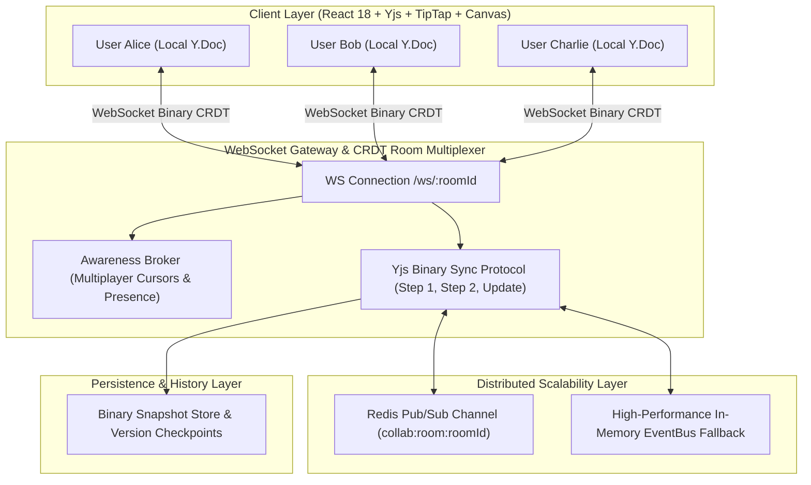

# 🚀 Real-Time Collaborative System (CRDT + Yjs + WebSockets + Redis Pub/Sub)

A production-grade, enterprise-ready **Real-Time Collaborative Workspace Suite** featuring a **Rich Collaborative Document Editor (Notion/Google Docs style)** and a **Live Interactive Whiteboard Canvas (Figma/Excalidraw style)** powered by **Conflict-free Replicated Data Types (CRDTs / Yjs)**, **WebSockets**, **Redis Pub/Sub**, and **Optimistic UI updates**.

---

## 🌟 Key Architecture & Concepts



### 1. Conflict-Free Replicated Data Types (CRDTs / Yjs)
- **Commutative & Associative**: Independent edits merge automatically in any order across peers without centralized lock contention or operational transformation (OT) complexity.
- **State Vectors & Delete Sets**: Minimal network payloads with differential byte sync (`Y.encodeStateAsUpdate`, `Y.applyUpdate`, `Y.encodeStateVector`).
- **Mathematical Convergence**: Ensures identical document and whiteboard canvas state across all connected devices.

### 2. Real-Time Multiplayer Awareness & Cursors
- **Live Cursors & Name Tags**: Real-time position tracking with custom avatar colors and smooth CSS interpolation.
- **Selection Highlights & Typing Indicators**: Visual feedback when peers are actively selecting or typing blocks.
- **Live Ephemeral Reactions (Figma style)**: Instant floating emoji bursts (`🚀`, `🔥`, `🎉`, `❤️`, `👍`, `💡`) triggering animations at peer cursor positions.

### 3. Redis Pub/Sub Distributed Scaling & In-Memory Fallback
- **Multi-Server Clustering**: Channels `collab:room:${roomId}` distribute delta updates and awareness across horizontal gateway instances.
- **Auto-Detecting In-Memory Fallback**: Seamless fallback to an in-memory event bus if Redis is not running locally, ensuring 100% plug-and-play capability.

### 4. Optimistic UI Updates & Latency Compensation
- **Zero-Latency Local Feedback**: Edits apply immediately to the local Yjs Doc and UI before socket roundtrip.
- **Offline Catch-Up Mode**: Disconnect network, perform local modifications, reconnect, and watch fast-forward CRDT convergence.

---

## 🎨 Features & Capabilities

### 📝 1. Rich Collaborative Document Editor (Notion / Google Docs style)
- **TipTap + Yjs Collaboration**: Seamless block and inline editing.
- **Full Formatting Palette**: Headings (H1, H2, H3), Bold, Italic, Underline, Strikethrough, Code, Highlighting.
- **Lists & Tasks**: Interactive collaborative checklists (`taskList` / `taskItem`), bulleted lists, numbered lists.
- **Code Blocks & Quotes**: Monospace code snippets and blockquotes.
- **Document Metadata Sync**: Real-time synchronized document titles and author tags.
- **Word & Character Counters**: Live reading metrics and statistics.

### 🎨 2. Live Collaborative Whiteboard / Canvas (Figma / Excalidraw style)
- **Multiplayer Shapes**: Rectangles, Circles, Decision Diamonds, Directional Arrows, Sticky Notes, Freehand Pen strokes, and Rich Text Labels.
- **Interactive Editing**: Live dragging, resizing, z-index re-ordering (Bring to Front, Send to Back), inline double-click text editing.
- **Color & Style Pickers**: Custom stroke colors, background fills, and stroke thickness.
- **Canvas Viewport**: Infinite grid background, Zoom (30% to 250%), Pan (drag canvas or hold Space/Hand tool), Reset View.
- **Undo / Redo Manager**: Dedicated `Y.UndoManager` for canvas elements.

### 👥 3. Multi-User Split-Screen Simulation Sandbox
- **1-Click Multiplayer Test**: Split the screen into **2 or 3 independent simulated peers** ("Alice", "Bob", "Charlie") in a single browser window.
- **Independent Actors**: Each pane runs its own WebSocket connection, client ID, cursor color, and awareness state to test real-time collaboration side-by-side.

### 🔬 4. CRDT State Inspector & Latency / Chaos Simulator
- **Live State Inspection**: Inspect Yjs StructStore client IDs, State Vector binary size, and total processed updates.
- **Synthetic Network Lag Slider**: Introduce 0ms to 1500ms artificial network delay to visually witness optimistic local rendering vs remote convergence.
- **Airplane / Offline Mode Toggle**: Simulate dropped connections and test automatic recovery.

### 🕒 5. Version History & Checkpoint Restore
- **Immutable Snapshots**: Create named checkpoints (e.g. "Release 1.0 Milestone").
- **Time-Travel Restore**: 1-click restore to any previous CRDT snapshot state.

### 💬 6. Live In-Room Discussion & Ephemeral Reactions
- **Sliding Chat Drawer**: In-room team discussions with user avatar badges and timestamps.
- **Figma Reaction Bar**: Floating emoji bursts with physics animation and confetti celebration.

### 💾 7. Multi-Format Export
- Export documents to **Markdown (.md)** or **CRDT State Snapshot (.json)**.

---

## ⚡ Quick Start

### 1. Install Dependencies
```bash
# Install root, server, and client packages
npm install
cd server && npm install
cd ../client && npm install
```

### 2. Start Dev Environment
Run both backend WebSocket server and frontend React client with a single command:
```bash
npm run dev
```

- **Frontend Client**: [http://localhost:5173](http://localhost:5173)
- **Backend API & WebSocket Server**: [http://localhost:4000](http://localhost:4000) (`ws://localhost:4000/ws/:roomId`)

---

## 📂 Project Structure

```
├── client/                     # Frontend Application (React 18 + Vite + Tailwind + TipTap)
│   ├── src/
│   │   ├── components/
│   │   │   ├── Collaboration/  # PresenceBar, MultiplayerCursors, LiveChat, Reactions
│   │   │   ├── Debugger/       # CRDTInspector & Latency Chaos Simulator
│   │   │   ├── Editor/         # CollabEditor (TipTap + Yjs ProseMirror collaboration)
│   │   │   ├── Navigation/     # Sidebar, Navbar, UserProfileModal
│   │   │   ├── Sandbox/        # SplitSandboxView (Side-by-side multi-user simulation)
│   │   │   ├── Versions/       # VersionHistoryModal (Snapshot time-travel)
│   │   │   └── Whiteboard/     # CollabWhiteboard (Canvas, Shapes, Sticky notes, Pen)
│   │   ├── lib/
│   │   │   ├── crdt/           # useYjsRoom hook, Y.Doc & WebSocket provider lifecycle
│   │   │   ├── utils/          # API client, User profile & color generator
│   │   │   └── types.ts        # TypeScript definitions
│   │   ├── App.tsx             # Main workspace application shell
│   │   └── index.css           # Styling, collaborative cursors, grid patterns
├── server/                     # Backend Service (Node.js + Express + WebSockets + Yjs)
│   ├── src/
│   │   ├── crdt-room.ts        # Room manager, Yjs Doc sync, awareness multiplexer
│   │   ├── pubsub.ts           # Redis Pub/Sub adapter with In-Memory fallback
│   │   ├── storage.ts          # Persistence manager, snapshots & seeded docs
│   │   ├── types.ts            # Server interfaces & metrics
│   │   └── server.ts           # Express REST API & WebSocket upgrade gateway
├── start-dev.mjs               # Development orchestrator running client & server
├── package.json                # Root project configuration
└── README.md                   # System documentation
```

---

## 🧪 Testing Collaboration

1. Open [http://localhost:5173](http://localhost:5173) in your browser.
2. Click the **"👥 Split Sandbox"** button in the top navbar.
3. Type into Alice's window or draw on Bob's whiteboard canvas — watch live caret streaming, multiplayer presence, and shape updates replicate instantly!
4. Open the **"🔬 CRDT Inspector"** to inspect state vectors or test the synthetic network delay slider.
